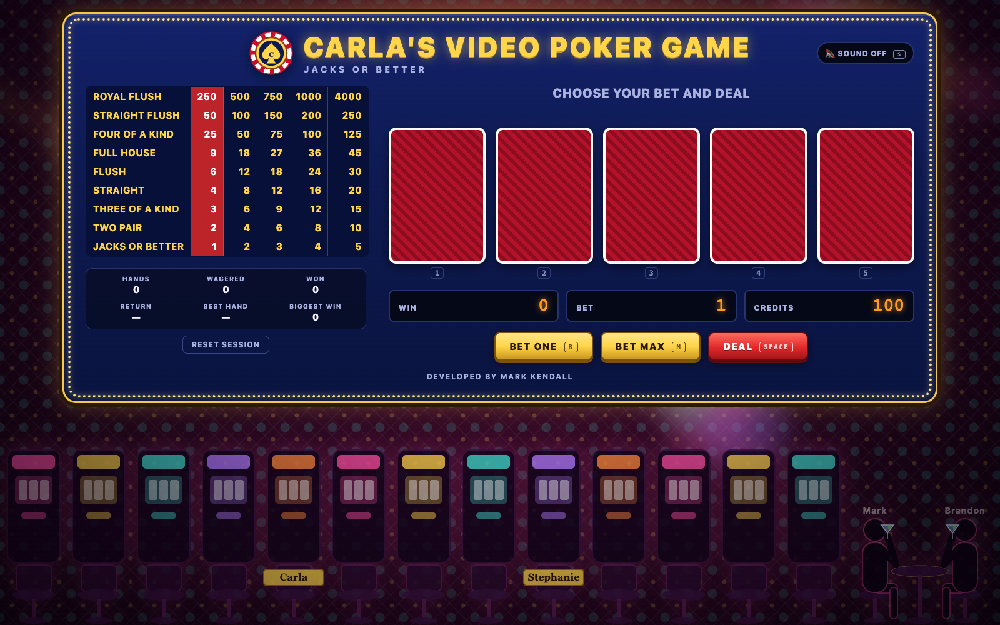

# Carla's Video Poker Game

*Developed by Mark Kendall.*

A Jacks or Better video poker machine for the browser, built with React. It was built in small, verified steps from intent files, then attacked with an adversarial test suite to find what breaks.

**Play it:** http://carlas-video-poker-mkendall.s3-website.us-east-2.amazonaws.com



## Features

- The full **9/6 Jacks or Better** paytable, with the 4,000-credit royal flush bonus on a 5-credit bet
- **Double Up** after any win: beat the dealer's card to double your winnings
- **Keyboard play**, real playing-card faces, and a win meter that counts up
- **Sound effects** synthesized in the browser (no audio files), off until you turn them on
- **Session stats**: hands, wagered, won, return %, best hand, biggest win
- **Saves automatically** in your browser; saved data is validated before it's trusted
- A **casino floor** around the machine, with marquee lights and a gold-coin shower when you win
- Works on **phones** with touch, and spreads out across **wide screens**

## Run it

```bash
npm install
npm run dev        # play at the URL Vite prints (usually http://localhost:5173)
npm run build      # production build in dist/
```

## How to play

1. **Bet One** raises the bet by 1 (1 to 5, then back to 1). **Bet Max** sets the bet to 5 and deals.
2. **Deal** gives you five cards. Click or tap the cards you want to keep; they show **HELD**.
3. **Draw** replaces every card you didn't hold. Winning hands pay from the paytable, and the row lights up.
4. You start with 100 play-money credits. When you run out, **Start Over** resets to 100.

### Keyboard

| Key | Action |
|---|---|
| `1`–`5` | Hold or release that card |
| `Space` / `Enter` | Deal, Draw, or Start Over |
| `B` | Bet One |
| `M` | Bet Max (deals) |
| `D` / `C` | Double Up / Collect (after a win) |
| `1`–`4` | Pick a card during Double Up |
| `S` | Sound on / off (starts off) |

### Double Up

After any win you can **Double Up** or **Collect**.

1. **Start:** Double Up takes the win out of your credits as the stake, then shows the dealer's card and four face-down cards.
2. **Pick:** choose one of the four. Aces are high.
   - **Higher:** the stake is doubled and paid.
   - **Equal:** the stake is returned (push).
   - **Lower:** the stake is lost.
3. **Keep going or stop:** after a win or a push you can double again, collect, or just deal the next hand. Collecting or dealing keeps what you've won.

### Sound and stats

- **Sound:** effects are synthesized in the browser (Web Audio), with no audio files. Sound starts off; press `S` or the Sound button to turn it on.
- **Stats:** the panel under the paytable shows hands played, credits wagered and won, your return percentage, your best hand and your biggest win. Double Up results count toward credits won. Start Over keeps the session stats.

### Saving and reset

- **Saved automatically:** credits, bet and session stats are kept in your browser (`localStorage`) and come back when you reload. Saved data is checked on load, and anything invalid starts a fresh game.
- **Reloading mid-hand or mid-Double Up:** the bet or stake already taken stays taken, as if you walked away from a real machine. The machine comes back ready to deal.
- **Reset Session:** sets credits back to 100 and clears the stats, after you confirm.

## Rules (9/6 Jacks or Better)

| Hand | Pays per credit |
|---|---|
| Royal Flush | 250 (4,000 on a 5-credit bet) |
| Straight Flush | 50 |
| Four of a Kind | 25 |
| Full House | 9 |
| Flush | 6 |
| Straight | 4 |
| Three of a Kind | 3 |
| Two Pair | 2 |
| Jacks or Better | 1 |

Payouts include the bet, so a pair of jacks or better gets your bet back.

### Rule assumptions

- A single 52-card deck, freshly shuffled for every hand. Replacement cards come from the same deck, so a card never appears twice in a hand.
- Aces count high or low in straights (10-J-Q-K-A and A-2-3-4-5). Straights don't wrap (Q-K-A-2-3 isn't a straight).
- The bet is taken when the hand is dealt and can't change until the draw. If the bet is more than your credits, the game bets what you have left. The royal flush bonus needs a real 5-credit bet.
- **Bet Max** deals immediately, as on a real machine.
- Credits are play money only. They're saved in your browser, not on a server.

## Testing

There are two separate suites.

| Command | What it is | Result |
|---|---|---|
| `npm test` | **Regression suite**: 101 tests written alongside the code (rules, game flow, Double Up, stats, sound, saving, celebrations) | 101 passing |
| `npm run test:tdd` | **Adversarial suite** in [`TDD/`](TDD/): tries to *break* the game | 34 passing |
| `node TDD/mutate.mjs` | **Mutation check**: plants 7 deliberate bugs, one at a time, and confirms the adversarial suite catches each one | 7/7 caught |

### The TDD folder: trying to break the game

Tests written by the same author as the code tend to share its assumptions. The [`TDD/`](TDD/) suite is built to be fair rather than flattering:

- **Every test checks against an independent source, never against the code under test:**
  - **[MATH]** published counts for all 2,598,960 five-card hands
  - **[REF]** a second hand evaluator written a different way
  - **[RULES]** the paytable as written in the intent
  - **[STATS]** a chi-square test of shuffle fairness
  - **[BOOKS]** an accounting identity: credits = baseline + won − wagered, checked after every one of 90,000 random actions
  - **[INPUT]** the documented input domain
- **Proof the tests can fail:** [`TDD/mutate.mjs`](TDD/mutate.mjs) records which tests already fail, plants each bug, and counts it caught only if a test that previously passed now fails. It always restores the source.
- **Findings were reported, then fixed separately.** The first run broke the game in two places:
  - the bet accepted non-whole numbers
  - saves over 1 billion credits were silently thrown away

  Both were fixed in a follow-up intent without changing a single test. The full story is in [`TDD/FINDINGS.md`](TDD/FINDINGS.md).

## How it was built

Each step started as an intent file in [`intents/`](intents/): a goal, inputs, outputs, checkable success criteria and a stop condition. Each was built with the [Intent Kit](https://github.com/kendallmark3/intent-kit-plugin) plugin for Claude Code. Before any code changed, the plan was checked against the real code (`check-plan`). Every intent ends with an evidence table showing how each criterion was proven.

| Round | Intent | What it added |
|---|---|---|
| 1 | [videopoker.md](intents/videopoker.md) | The playable game: paytable, deal / hold / draw, credits, bets |
| 2 | [machine-feel.md](intents/machine-feel.md) | Keyboard play, real card faces, count-up wins |
| 3 | [double-up.md](intents/double-up.md) | Double Up bonus |
| 4 | [sound-and-stats.md](intents/sound-and-stats.md) | Synthesized sound, session stats |
| 5 | [save-and-mobile.md](intents/save-and-mobile.md) | Validated saves, Reset Session, phone layout |
| 6 | [carls-branding.md](intents/carls-branding.md) | Logo, wide two-column layout |
| 7 | [casino-fun.md](intents/casino-fun.md) | Casino floor, marquee lights, coin shower |
| 8 | [casino-crowd.md](intents/casino-crowd.md) | Machine at the top, named seats and onlookers |
| 9 | [carla-name.md](intents/carla-name.md) | Carla's Video Poker Game, developer credit |
| TDD | [break-the-game.md](intents/break-the-game.md) | Adversarial suite and mutation check |
| Fix | [fix-break-findings.md](intents/fix-break-findings.md) | Fixes for both findings |

Screenshots from each round's browser checks are in [`screenshots/`](screenshots/).

## Project structure

```
src/
  poker.js        deck, shuffle, hand evaluator, paytable, payouts (pure)
  game.js         game state transitions, Double Up, stats (pure)
  storage.js      validated save / load
  cards.js        card-face layout data
  celebrate.js    win celebration size
  sound.js        synthesized sound effects
  Casino.jsx      casino backdrop and coin shower
  App.jsx         the machine
  *.test.js       regression suite
TDD/              adversarial suite, mutation check, findings
intents/          one intent per step, each with its evidence
screenshots/      browser-check screenshots
```

Game rules live in plain JavaScript modules with no React. That's what makes them easy to test exhaustively.

## Deploy

The build is a static site, so any static host works. For an S3 static website:

```bash
npm run build
aws s3 sync dist s3://<your-bucket> --delete
```

Credentials come from your own AWS CLI profile. None are stored in this repository.
