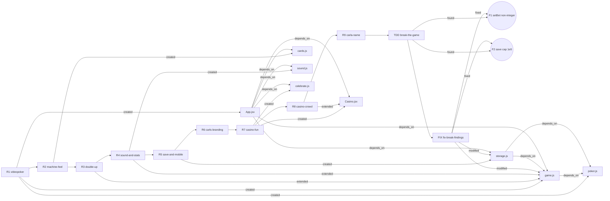

# Memory Map: Carla's Video Poker Game

The project's memory as a graph. **Read this before starting any new progressive intent. Update it as the last step of every intent run.** It is shaped for conversion to a JSON graph: every node has a stable `id`, and every edge is `from → rel → to`.

*Last updated: after `fix-break-findings` + README (commit `a7c46a1`). Regression 101/101, TDD 34/34, mutation check 7/7.*

## Graph

## Nodes

### Intents (one per progressive round, in order)

| id | label | path | commit | tests after | status |
|---|---|---|---|---|---|
| intent:R1 | Playable Jacks or Better game | intents/videopoker.md | 01b68bc | 33 | done |
| intent:R2 | Machine feel: keyboard, real card faces, count-up | intents/machine-feel.md | 7a28dd8 | 47 | done |
| intent:R3 | Double Up bonus | intents/double-up.md | b115acf | 60 | done |
| intent:R4 | Synthesized sound and session stats | intents/sound-and-stats.md | 0a2ad60 | 70 | done |
| intent:R5 | Validated saves, Reset Session, phone layout | intents/save-and-mobile.md | c25f801 | 88 | done |
| intent:R6 | Branding, logo, wide two-column layout | intents/carls-branding.md | c36ab27 | 88 | done |
| intent:R7 | Casino floor, marquee, coin shower | intents/casino-fun.md | 3859d91 | 100 | done |
| intent:R8 | Machine at top, named seats and onlookers | intents/casino-crowd.md | 40679c5 | 100 | done |
| intent:R9 | Name: Carla's Video Poker Game, credit Mark Kendall | intents/carla-name.md | 69401cc | 100 | done |
| intent:TDD | Adversarial break-the-game suite and mutation check | intents/break-the-game.md | 579b3ed | 100 + TDD 29/34 | done |
| intent:FIX | Fix TDD findings F1 and F2 | intents/fix-break-findings.md | 558f610 | 101 + TDD 34/34 | done |

### Modules

| id | label | path |
|---|---|---|
| module:poker | Deck, shuffle (injectable rng), evaluator, 9/6 paytable, payouts | src/poker.js |
| module:game | Pure state transitions, Double Up, stats | src/game.js |
| module:storage | Validated save and load | src/storage.js |
| module:cards | Pip layouts and card labels | src/cards.js |
| module:celebrate | Win celebration tier (0–3) | src/celebrate.js |
| module:sound | Web Audio effects, muted by default | src/sound.js |
| module:casino | Casino backdrop, floor scene, coin shower | src/Casino.jsx |
| module:app | The machine UI, actions, keys, effects | src/App.jsx, src/App.css |

### Test suites

| id | label | path | count |
|---|---|---|---|
| tests:regression | Regression suite | src/*.test.js | 101 |
| tests:tdd | Adversarial suite (independent oracles) | TDD/break-the-game.test.js | 34 |
| tests:mutation | Mutation check (7 planted bugs) | TDD/mutate.mjs | 7/7 caught |

### Decisions and invariants (do not break these)

| id | rule | set by |
|---|---|---|
| decision:same-state | An invalid action returns the **same state object**. Tests use `toBe`. | intent:R1 |
| decision:books | credits = baseline + won − wagered (− stake mid-double); Start Over resets the baseline | intent:R1, intent:R3, intent:R4 |
| decision:win-credited-on-draw | The win is credited on draw; Double Up takes the stake back out | intent:R3 |
| decision:latest-state | UI actions read `gameRef` and use functional `setGame`; buttons and keys share `actions` | intent:R1, intent:R2 |
| decision:sound-muted | Sound starts muted; the audio context is created inside a user gesture | intent:R4 |
| decision:startover-keeps-stats | Start Over resets credits and keeps the session stats | intent:R4 |
| decision:no-refund | A reload mid-hand or mid-double forfeits the bet or stake | intent:R5 |
| decision:untrusted-save | Saves are validated field by field; anything invalid gives a new game | intent:R5 |
| decision:no-random-decor | Decoration never calls `Math.random` (browser checks seed it) | intent:R7 |
| decision:jacks-celebrate | Jacks or Better gets the small celebration (tier 1) | intent:R7 |
| decision:whole-bets | `setBet` ignores non-numbers and truncates fractions | intent:FIX |
| decision:credit-range | Game and storage share one range, any safe integer; `canDouble` guards it | intent:FIX |
| decision:no-test-edits | Never edit existing tests or TDD assertions to get green | intent:TDD |

### Findings

| id | finding | found by | status |
|---|---|---|---|
| finding:F1 | `setBet` accepted 2.5, NaN and undefined | intent:TDD | fixed by intent:FIX |
| finding:F2 | Saves over 1e9 credits were rejected, resetting the player | intent:TDD | fixed by intent:FIX |
| finding:C2 | Keyboard listener would get stuck dealing (stale closure) | check-plan R2 | fixed in R2 |
| finding:C3 | Space during Double Up would re-animate the cards | check-plan R3 | fixed in R3 |
| finding:C4 | Audio blocked unless created inside a user gesture | check-plan R4 | fixed in R4 |
| finding:C5 | Reset mid-hand would crash (null `result` in the sound effect) | check-plan R5 (blocker) | fixed in R5 |
| finding:C7 | The coin shower would block clicks; a second win would cut it short | check-plan R7 | fixed in R7 |
| finding:S1 | A quick second hold was lost (stale state) | screenshot R1 | fixed in R1 |
| finding:S2 | The machine rendered 560px wide | screenshot R2 | fixed in R2 |
| finding:S7 | Coin timer kept restarting; white strip below long pages | review R7 | fixed in R7 |

### Open items

| id | item |
|---|---|
| open:stephanie | The seat name is "Stephanie"; the spelling given was S-T-E-P-H-A-N-E. Unconfirmed. |
| open:draw-overflow | Accepted: `draw` has no ceiling near 9×10¹⁵ credits (unreachable in practice) |
| open:https | The S3 site is http only; https needs CloudFront |

### Deployments

| id | label | where |
|---|---|---|
| deploy:s3 | Live site | http://carlas-video-poker-mkendall.s3-website.us-east-2.amazonaws.com (bucket `carlas-video-poker-mkendall`, us-east-2) |
| deploy:github | Source | https://github.com/kendallmark3/video-poker (`main`) |

## Edges

| from | rel | to |
|---|---|---|
| intent:R1 | precedes | intent:R2 |
| intent:R2 | precedes | intent:R3 |
| intent:R3 | precedes | intent:R4 |
| intent:R4 | precedes | intent:R5 |
| intent:R5 | precedes | intent:R6 |
| intent:R6 | precedes | intent:R7 |
| intent:R7 | precedes | intent:R8 |
| intent:R8 | precedes | intent:R9 |
| intent:R9 | precedes | intent:TDD |
| intent:TDD | precedes | intent:FIX |
| intent:R1 | created | module:poker |
| intent:R1 | created | module:game |
| intent:R1 | created | module:app |
| intent:R2 | created | module:cards |
| intent:R2 | modified | module:app |
| intent:R3 | modified | module:game |
| intent:R3 | modified | module:app |
| intent:R4 | created | module:sound |
| intent:R4 | modified | module:game |
| intent:R4 | modified | module:app |
| intent:R5 | created | module:storage |
| intent:R5 | modified | module:app |
| intent:R6 | modified | module:app |
| intent:R7 | created | module:celebrate |
| intent:R7 | created | module:casino |
| intent:R7 | modified | module:app |
| intent:R8 | modified | module:casino |
| intent:R9 | modified | module:app |
| intent:TDD | created | tests:tdd |
| intent:TDD | created | tests:mutation |
| intent:TDD | found | finding:F1 |
| intent:TDD | found | finding:F2 |
| intent:FIX | fixed | finding:F1 |
| intent:FIX | fixed | finding:F2 |
| intent:FIX | modified | module:game |
| intent:FIX | modified | module:storage |
| module:game | depends_on | module:poker |
| module:storage | depends_on | module:game |
| module:storage | depends_on | module:poker |
| module:app | depends_on | module:game |
| module:app | depends_on | module:storage |
| module:app | depends_on | module:sound |
| module:app | depends_on | module:celebrate |
| module:app | depends_on | module:casino |
| module:app | depends_on | module:cards |
| tests:regression | covers | module:poker |
| tests:regression | covers | module:game |
| tests:regression | covers | module:storage |
| tests:regression | covers | module:cards |
| tests:regression | covers | module:celebrate |
| tests:regression | covers | module:sound |
| tests:tdd | covers | module:poker |
| tests:tdd | covers | module:game |
| tests:tdd | covers | module:storage |
| tests:tdd | covers | module:celebrate |
| tests:mutation | verifies | tests:tdd |
| intent:FIX | deployed_to | deploy:s3 |
| intent:FIX | pushed_to | deploy:github |

## How to update after each intent run

1. Add an `intent:<slug>` node: label, path, commit, test count after, status.
2. Add edges: `precedes` from the previous intent, plus `created`, `modified`, `found`, `fixed` or `deployed_to` as they happened.
3. Add any new `decision:*` the intent established, and any `finding:*` that `check-plan`, screenshots or tests caught.
4. Move resolved `open:*` items to their fixing intent, and add new ones.
5. Update the "Last updated" line, and the Mermaid graph if a module or intent was added.
